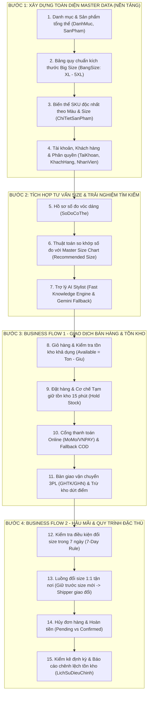

# 🏗️ KẾ HOẠCH TRIỂN KHAI & THỨ TỰ PHÁT TRIỂN HỆ THỐNG (MASTER DATA FIRST)
## DỰ ÁN: CURVE & CONFIDENCE – HỆ THỐNG THỜI TRANG BIG SIZE TRỰC TUYẾN
- **Định hướng chỉ đạo**: Thầy Trần Thanh Nguyên
- **Chiến lược cốt lõi**: **Data-Centric & Master Data First** (Xây dựng và kiểm thử vững chắc dữ liệu nền tảng trước khi triển khai các luồng giao dịch nghiệp vụ).

---

## 1. TẠI SAO PHẢI ƯU TIÊN MASTER DATA TRƯỚC?
Trong một hệ thống phần mềm thương mại thực tế:
- **Đơn hàng (Order)** không thể tồn tại nếu không có **Sản phẩm & Biến thể SKU**.
- **Biến thể SKU** không thể bán được nếu không có **Bảng đo kích cỡ (Size Chart)** quy chuẩn số đo 3 vòng cho người béo/mập.
- **Tồn kho (Inventory)** không thể kiểm đếm nếu chưa định danh được chính xác mã SKU duy nhất theo Màu và Kích cỡ.
- **Tư vấn size (Body Profile & AI)** không thể gợi ý chính xác nếu dữ liệu dải đo trong bảng Master Size Chart chưa được thiết lập chuẩn xác.

Do đó, bất kỳ nỗ lực làm giao diện Checkout hay Giỏ hàng trước khi hoàn thiện Master Data đều là "lâu đài xây trên cát" và sẽ bị giảng viên đánh giá là chỉ dựng giao diện web thông thường.

---

## 2. LỘ TRÌNH 4 BƯỚC PHÁT TRIỂN TUẦN TỰ (ROADMAP)

---

## 3. CHI TIẾT CÁC GÓI CÔNG VIỆC THEO PHÂN CÔNG THÀNH VIÊN

### GÓI 1: MASTER DATA CỬA HÀNG & SẢN PHẨM (Phụ trách chính: Kiều Duyên)
- **Nhiệm vụ 1.1**: Xây dựng màn hình Quản lý Danh mục (CRUD). Validate không cho trùng tên, chặn xóa danh mục đang có sản phẩm.
- **Nhiệm vụ 1.2**: Xây dựng màn hình Quản lý Sản phẩm cha (Thêm, sửa, ảnh đại diện, mô tả chất liệu co giãn 4 chiều).
- **Nhiệm vụ 1.3**: Xây dựng màn hình Cấu hình Bảng Size Chart Big Size cho từng sản phẩm. Bắt buộc nhập dải đo min/max cho các size từ `XL`, `2XL`, `3XL`, `4XL`, đến `5XL`.
- **Nhiệm vụ 1.4**: Xây dựng màn hình Sinh biến thể SKU tự động theo ma trận `[Màu sắc] x [Kích cỡ]`. Nhập giá bán và tồn kho ban đầu cho từng SKU.

### GÓI 2: MASTER DATA TÀI KHOẢN & PHÂN QUYỀN (Phụ trách chính: Nho Toàn)
- **Nhiệm vụ 2.1**: Xây dựng module Xác thực (Đăng ký, Đăng nhập JWT, Quên mật khẩu).
- **Nhiệm vụ 2.2**: Xây dựng màn hình Quản lý Người dùng trong Admin Portal:
  - Xem danh sách người dùng từ Database.
  - Phân quyền động giữa `ADMIN`, `MANAGER`, `CUSTOMER`.
  - Khóa / Mở khóa tài khoản có ghi nhận Audit Log.

### GÓI 3: BODY PROFILE & LOGIC ĐỐI CHIẾU SIZE (Phụ trách chính: Quốc Khánh)
- **Nhiệm vụ 3.1**: Xây dựng màn hình Quản lý nhiều hồ sơ số đo cá nhân (Quản lý chiều cao, cân nặng, số đo 3 vòng của khách hàng).
- **Nhiệm vụ 3.2**: Viết hàm Service so khớp số đo khách hàng với bảng `BangSize` thật trong Database để gợi ý size tự động.
- **Nhiệm vụ 3.3**: Hoàn thiện Trợ lý AI Stylist đa kênh (gồm lớp phản hồi tức thì và lớp dự phòng Gemini).

### GÓI 4: ORDER, TỒN KHO & HẬU MÃI (Phụ trách chính: Khánh Ngân)
- **Nhiệm vụ 4.1**: Kết nối Giỏ hàng & Checkout vào bảng `ChiTietSanPham` thật, kiểm tra tồn kho trước khi cho thêm vào giỏ.
- **Nhiệm vụ 4.2**: Áp dụng cơ chế Tạm giữ số lượng `so_luong_giu` khi khách bấm thanh toán.
- **Nhiệm vụ 4.3**: Xây dựng giao diện và luồng xử lý Đổi size 1:1 tận nơi trong 7 ngày, kiểm tra tính hợp lệ của đơn hàng trước khi cho phép bấm đổi hàng.

---

## 4. TIÊU CHÍ NGHIỆM THU MASTER DATA TRƯỚC KHI CHUYỂN BƯỚC
Để đảm bảo Thầy kiểm tra bất ngờ vào cơ sở dữ liệu đều đạt chuẩn, nhóm áp dụng Checklist nghiệm thu:
1. [ ] **Tính toàn vẹn dữ liệu (Integrity)**: Mọi bảng `ChiTietSanPham` đều có `ma_sp` và `ma_bang_size` hợp lệ, không có dữ liệu mồ côi (Orphan records).
2. [ ] **Tính duy nhất (Uniqueness)**: Không tồn tại 2 SKU trùng nhau hoặc trùng cặp `(Màu, Size)` trên cùng một sản phẩm.
3. [ ] **Quy chuẩn đo đạc Big Size**: Không có sản phẩm nào có size nhỏ hơn `XL` hoặc thiếu dải đo vòng eo/vòng bụng.
4. [ ] **Trạng thái tồn kho**: Không có biến thể nào có số lượng tồn kho âm (`so_luong_ton < 0`).
